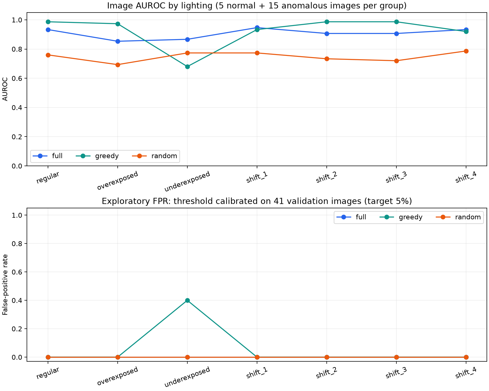

# Kết quả đánh giá pilot01 · Đỗ Hoàng Phúc

Ngày 26/11/2026. Xem [giao thức và lệnh chạy](evaluation.md). **Các phép đo tại ngưỡng và phân nhóm lỗi nhỏ là thăm dò theo đề xuất v 0.3, chờ nhóm rà; chưa phải kết quả với giao thức chính thức.**

## Kiểm đầu vào

Đã kiểm 472 hàng manifest, 543 dự đoán, 105 mask gốc và 543 map. CSV tải từ Drive có SHA 256 giống hệt CSV đã nhận trước đó. Ba run có cùng 41 validation và 140 test_public; không có ID thiếu/trùng/thừa. Mask thực tế là 0/255, H×W=(1900,1400); map float 32, shape 224 × 224, hữu hạn.

105/105 mask còn lỗi sau crop. Không mất hoàn toàn vùng liên thông gốc nào ở resize/crop, nhưng **7 mask thuộc tiền tố bad/014 mất 194/1785 pixel lỗi sau resize**, còn 1591 pixel trong crop. Do đó “còn lỗi” không có nghĩa “giữ nguyên diện tích lỗi”. Đây là số pixel trong hệ tọa độ 256 × 256, không phải diện tích pixel ảnh gốc.

## Chất lượng không phụ thuộc ngưỡng

| Cấu hình | Image AUROC | Pixel AP trên crop 224 × 224 |
|---|---:|---:|
| Full | 0.887891 | 0.341058 |
| Random | 0.751837 | 0.339207 |
| Approximate Greedy | 0.891429 | 0.324905 |

Image AUROC tính trên 35 ảnh chuẩn và 105 ảnh lỗi. Pixel AP gộp 7.024.640 pixel, trong đó 193.459 pixel dương, gồm cả ảnh good có mask 0. AP là average precision của sklearn, không phải hình thang PR-AUC. Kết quả này cho thấy xếp hạng phương pháp theo chất lượng cấp ảnh và cấp pixel có thể khác nhau.

Anomalib 2.2.0, sklearn và công thức hạng khớp AUROC với sai số tuyệt đối tối đa 4,3 e-8. Ví dụ bốn điểm có đáp án cho 1,0; ví dụ hai điểm bằng nhau khác lớp cho 0,5. [Log kiểm Anomalib](../results/evaluation/pilot01/anomalib-check.json).

Greedy có AUROC 0,9867 ở regular nhưng 0,6800 ở underexposed; Full ở underexposed là 0,8667. Chênh lệch này là mô tả của một category/seed. Từng nhóm chỉ có 5 good+15 bad; Hữu Phúc xác nhận cùng 20 lọ lặp lại giữa các mức sáng. Không kết luận ý nghĩa thống kê hoặc nguyên nhân chỉ từ bảng.

## Ví dụ vận hành đề xuất: mục tiêu calibration FPR 5%

Ngưỡng được lấy riêng từng run từ cùng 41 validation good; mỗi run có 2/41 cảnh báo trên validation. Bảng dưới dùng ảnh test_public thuộc split khác validation; chưa xác nhận tính độc lập của mẫu vật giữa hai split.

| Cấu hình | Ngưỡng (làm tròn để đọc) | Báo nhầm /35 good | Phát hiện /105 bad | Recall tất cả lỗi |
|---|---:|---:|---:|---:|
| Full | 3.963692 | 0/35 | 48/105 | 45.71% |
| Random | 5.870096 | 0/35 | 41/105 | 39.05% |
| Greedy | 4.402119 | 2/35 | 54/105 | 51.43% |

Ngưỡng CSV giữ đủ độ chính xác `nextafter`; không lấy giá trị làm tròn ở bảng này để chạy lại quy tắc >=. Hai báo nhầm của Greedy nằm trong underexposed:2/5=40%. Không kết luận Full/Random không bao giờ báo nhầm chỉ vì thấy 0/35 ở pilot này.

Toàn bộ mục tiêu {1%,5%,10%} đều được lưu, không chọn 5% vì test tốt nhất. Đây chỉ là ví dụ minh họa cùng hình chẩn đoán.

## Độ nhạy lỗi nhỏ theo lưới định nghĩa đề xuất

Diện tích mỗi vùng liên thông 8 chia toàn ảnh gốc. Ảnh được chọn khi mọi vùng lỗi <= mức cắt. Kết quả tại mục tiêu calibration 5%:

| Mức cắt vùng lỗi | Số ảnh đủ điều kiện | Full phát hiện | Random phát hiện | Greedy phát hiện |
|---|---:|---:|---:|---:|
| 0.1% | 0 | Chưa tính được | Chưa tính được | Chưa tính được |
| 0.5% | 21 | 8/21 (38.10%) | 5/21 (23.81%) | 7/21 (33.33%) |
| 1% | 56 | 29/56 (51.79%) | 26/56 (46.43%) | 30/56 (53.57%) |

Không thay 0/0 bằng 0%. Việc đổi định nghĩa làm thay đổi tập mẫu và có thể đổi thứ tự phương pháp; nhóm phải ghi rõ định nghĩa trước đợt đánh giá xác nhận tiếp theo. Đây là recall cấp ảnh, không phải đo việc định vị trúng từng vùng nhỏ.

## Ca lỗi và hình

Script chọn ca đầu theo image ID trong nhóm Greedy FP/FN tại alpha 5%, không chọn bằng tay ca đẹp:

- FP: `vial/test_public/good/000_underexposed`, score 4.460339, threshold 4.402119000000001. Map kích hoạt cả phần nền quanh lọ; đây là quan sát trực quan, chưa chứng minh nguyên nhân.
- FN: `vial/test_public/bad/003_overexposed`, score 3.6694 khi làm tròn, dưới ngưỡng; ground truth ở vùng phía trên thân lọ. Map kích hoạt lan rộng, cảnh báo cấp ảnh không vượt ngưỡng.

Hai hình overlay `case_fp.png` và `case_fn.png` đã tạo và kiểm tại máy; script tái tạo được. Chúng dùng chung thang màu trong từng hình, có đường viền ground-truth và ID. Các hình chứa dữ liệu ảnh gốc được giữ ngoài commit; chỉ hình chỉ số và bảng/log được đưa lên Git.

## Tự kiểm và bước cần nhóm quyết định

- 7 test qua: AUROC, ngưỡng có điểm bằng nhau, dữ liệu calibration sai, liên thông 8, mất vùng do crop, thiếu/trùng asset, khớp resize/crop với torchvision.
- 24 hàng pixel_metrics,216 hàng quality (3 run × 3 alpha × 3 cutoff × 8 nhóm),9 ngưỡng,1.260 quyết định ảnh và 648 hash mask/map.
- Huy cần rà quy tắc calibration, mức cắt/ROI, ảnh nhiều cỡ lỗi và phạm vi pilot/final. Không xem lời phê duyệt sau khi đã xem test là đăng ký giao thức trước thí nghiệm.
- Hữu Phúc đã xác nhận cùng lọ/cảnh qua bảy mức sáng; cần làm rõ cách lấy mẫu và quan hệ mẫu vật giữa các split trước khi suy luận thống kê. Xem [ghi nhận bàn giao](specimen-handoff.md).
- Tiến ghép theo run ID và báo thời gian đo riêng; không dùng thời gian query theo batch của baseline làm p50/p95.
- AU-PRO, seed/category bổ sung, phương pháp mới và test nhãn ẩn thuộc giai đoạn tiếp theo; không được trình bày như đã hoàn tất ở đây.

File nguồn và đầu ra máy đọc được dẫn trong [giao thức](evaluation.md). Không có thay đổi nào tới code baseline của Hữu Phúc.
