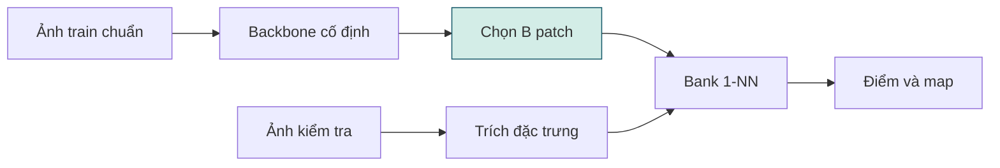

# Chọn coreset cho phát hiện bất thường công nghiệp khi bộ nhớ và độ trễ bị giới hạn

Đề cương nghiên cứu v1 · Nguyễn Đình Huy · 26/11/2026

## Câu hỏi và giả thuyết nghiên cứu

Defect-Preserving Robust Coreset Selection under Memory and Latency Constraints for Industrial Anomaly Detection

### Tại sao cần đo riêng lỗi nhỏ?

PatchCore lưu đặc trưng cục bộ của sản phẩm đạt chuẩn. Khi kiểm tra một ảnh mới, khoảng cách tới đặc trưng chuẩn gần nhất cung cấp tín hiệu bất thường. Việc bỏ bớt patch làm thay đổi điểm tham chiếu này. Trên nhóm lọ thủy tinh (vial), ánh sáng và phản xạ có thể làm một vùng đạt chuẩn trông khác thường, trong khi khuyết tật thật chỉ chiếm một phần rất nhỏ của ảnh.

Pilot của nhóm cho thấy vấn đề ngay ở baseline. Với index gần 1/100 dung lượng full bank, greedy đạt image AUROC 0,8914 so với 0,8879 của full. Nhưng tại điểm vận hành thăm dò đã phân tích, greedy cảnh báo đúng 7/21 ảnh chỉ có lỗi nhỏ, so với 8/21 của full. Chênh lệch một ảnh là lý do cần thiết kế phép kiểm đủ sức phân biệt hai mục tiêu.

### Câu hỏi có thể kiểm chứng

Ở cùng số patch và giới hạn độ trễ trên cùng thiết bị, liệu một bộ chọn được xây từ ảnh chuẩn có giảm báo động giả khi ánh sáng thay đổi, đồng thời giữ độ nhạy cấp ảnh với các khuyết tật nhỏ so với approximate greedy? Hiệu quả định vị được đánh giá riêng bằng anomaly map và mask.

### Phương pháp dự kiến

Nhóm chỉ thay quy tắc chọn B vector. Điểm cấp ảnh dùng khoảng cách patch lớn nhất theo cấu hình baseline.

Bắt đầu từ độ bao phủ của greedy. Trên dữ liệu chuẩn dành cho phát triển, tạo các cặp ảnh biến đổi ánh sáng có giới hạn và các nhiễu nhỏ cục bộ với vị trí biết trước. Thử ưu tiên ứng viên làm giảm phản ứng trên cặp ánh sáng nhưng còn giữ chênh lệch điểm tại vị trí nhiễu. Phép thử trên nhiễu tổng hợp chỉ cung cấp tín hiệu phát triển. Giá trị của tín hiệu này phải được kiểm tra bằng lỗi thật trên dữ liệu độc lập.

## Đối chiếu công trình gần nhất

| Công trình và vị trí | Điểm chồng lấn | Phép kiểm cần bổ sung |
| --- | --- | --- |
| PatchCore [1] · §3, tr. 3–5; bảng 1–3 | Greedy coreset giữ độ bao phủ của đặc trưng chuẩn. Tác giả đánh giá phát hiện và định vị. | Giữ B và truy vấn như nhau. Đo độ nhạy lỗi nhỏ, FPR từng ánh sáng và p95. |
| FAPM [2] · §2.1–2.2; bảng 2, tr. 4 | Bộ nhớ theo vị trí/layer và lấy mẫu thích nghi đã gắn việc chọn patch với tốc độ. | Tách tác dụng của ổn định ánh sáng khỏi tác dụng của lấy mẫu thích nghi. |
| PatchCore-Lite [3] · §III, tr. 4 | Nén vector bằng product quantization và tìm kiếm hai bước làm đổi chi phí truy vấn. | Giữ dtype và 1-NN cố định khi kiểm bộ chọn. Khi so với nén, ghép cặp theo byte thực. |
| ASO PatchCore [4] · tr. 423–430 | Tự chọn tỷ lệ lấy mẫu theo dữ liệu; có đánh giá trên MVTec AD 2. | Đối chứng ở cùng ngân sách và tách hiệu quả của việc đổi số lượng patch. |
| SubtleDC [5] · abstract, tr. 1376 | Chọn ảnh chuẩn few-shot theo độ lệch đặc trưng do lượng tử hóa, có liên hệ với tín hiệu lỗi tinh tế. | Giữ encoder, độ chính xác số và số patch cố định. Kiểm tác dụng của biến đổi ánh sáng ở cấp patch. |

### Điểm mới ứng viên

Giả thuyết nằm ở tiêu chí chọn patch chuẩn có xét đồng thời độ ổn định với ánh sáng và đáp ứng với nhiễu nhỏ, kèm phép đo trực tiếp trên lỗi thật dưới ngân sách triển khai. Các thành phần giảm bộ nhớ, lấy mẫu thích nghi và phân tích độ lệch đặc trưng đều đã có công trình liên quan.

Ablation dự kiến gồm greedy theo độ bao phủ, thêm riêng tiêu chí ánh sáng, thêm riêng tiêu chí lỗi cục bộ và kết hợp cả hai. Nếu cải thiện biến mất khi giữ nguyên B hoặc chỉ hiện trên nhiễu tổng hợp, nhóm thu hẹp luận điểm. Ghi cả nhóm sản phẩm và điều kiện ánh sáng gây suy giảm.

[1. Roth et al. · CVPR 2022](https://openaccess.thecvf.com/content/CVPR2022/html/Roth_Towards_Total_Recall_in_Industrial_Anomaly_Detection_CVPR_2022_paper.html) · [2. Kim et al. · FAPM](https://arxiv.org/abs/2211.07381) · [3. Stropeni et al. · PatchCore-Lite](https://arxiv.org/abs/2603.20288) · [4. ASO PatchCore · VISAPP 2026](https://www.scitepress.org/Papers/2026/144451/144451.pdf) · [5. Shinde · SubtleDC, CVPRW 2026](https://openaccess.thecvf.com/content/CVPR2026W/SVC/html/Shinde_SubtleDC_Drift-Guided_Coreset_Selection_for_Robust_Few-Shot_Industrial_Anomaly_Detection_CVPRW_2026_paper.html)

## Kết quả pilot trên nhóm vial

Bank được dựng từ 291 ảnh train chuẩn. Mỗi run dùng cùng 41 ảnh validation chuẩn để hiệu chỉnh ngưỡng. Tập test_public gồm 20 lọ (5 chuẩn, 15 lỗi), mỗi lọ chụp dưới bảy điều kiện sáng, tổng cộng 140 ảnh. Khi so hai điều kiện sáng, ghép theo loại good/bad và tiền tố ID của lọ.

| Cấu hình · seed 0 | Patch | Index (MiB) | Image AUROC | Pixel AP¹ | Báo nhầm | Lỗi nhỏ² |
| --- | --- | --- | --- | --- | --- | --- |
| Full | 228.144 | 891,19 | 0,8879 | 0,3411 | 0/35 | 8/21 |
| Random | 2.281 | 8,91 | 0,7518 | 0,3392 | 0/35 | 5/21 |
| Approx. greedy | 2.281 | 8,91 | 0,8914 | 0,3249 | 2/35 | 7/21 |

¹ AP theo bảng pixel_metrics của nhánh evaluation, trên crop 224 × 224. ² Độ nhạy cấp ảnh tại mục tiêu FPR hiệu chỉnh 5%. Mọi vùng lỗi liên thông 8 trong mask gốc phải chiếm tối đa 0,5% diện tích toàn ảnh. Đây là một điểm đọc trong lưới thăm dò đã công bố.

### Có thể kết luận gì từ các con số?

Ở cùng 2.281 patch, greedy đạt AUROC cao hơn random. 21 ảnh chỉ có lỗi nhỏ đến từ ba lọ (bad/007, 010, 011). Khi chuyển từ sáng chuẩn sang thiếu sáng, greedy đổi từ không cảnh báo sang cảnh báo ở 2/5 lọ chuẩn và 3/15 lọ lỗi. Ở mức diện tích 1%, greedy phát hiện 30/56 ảnh, full 29/56. Ở mức 0,1%, mẫu số bằng 0.

### Dấu vết kiểm chứng

Đã đối chiếu hash của manifest và predictions gốc, ghép 543 dòng dự đoán theo run ID và image ID, tính lại AUROC, ngưỡng và các tử số/mẫu số. Kết quả khớp bảng đánh giá. Ví dụ greedy có score 4,460339 trên vial/test_public/good/000_underexposed, vượt ngưỡng 4,402119…, nên tính là một báo động giả.

Dung lượng trong bảng là kích thước tệp FAISS IndexFlatL2. Chi phí peak VRAM và p50/p95 end-to-end trên NVIDIA L4 đang chờ đo. Số đo truy vấn trên cache trong baseline và phép thử bộ đo CPU của Tiến có phạm vi khác với suy luận một ảnh từ đầu đến cuối.

[Định nghĩa dataset và các split · MVTec](https://www.mvtec.com/research-teaching/datasets/mvtec-ad-2) · [Bảng đánh giá của nhóm](https://github.com/huyryan220806/robust-memory-ad/blob/56b0221824c457aa748d2e10638c8e11581f82f8/docs/evaluation-results-pilot01.md) · [Định danh 20 lọ](https://github.com/huyryan220806/robust-memory-ad/blob/56b0221824c457aa748d2e10638c8e11581f82f8/docs/specimen-handoff.md)

## Giao thức và quyết định tuần 2

### Thiết kế so sánh

Tiếp tục với Wide-ResNet50-2, layer2/layer3, resize vuông 256 rồi center-crop 224, 784 patch/ảnh, vector float32 1.024 chiều, 1-NN L2 chính xác. Seed 0 giữ làm mốc pilot. Full là mốc tham chiếu. Random, approximate greedy và bộ chọn mới dùng B = 2.281 trên 228.144 patch train. Bank rút gọn gồm 9.343.021 byte index và 230 byte tham số, tổng 9.343.251 byte. Trọng số backbone dùng chung được tính riêng.

Giữ một ngưỡng cho mọi điều kiện ánh sáng của mỗi run. Tại α = 5%, sắp 41 điểm validation tăng dần, lấy điểm đứng thứ 39 rồi dịch lên số float64 kế tiếp. Cảnh báo khi score ≥ ngưỡng. Báo cả hai mức nhạy α = 1% và 10%. Dùng lưới diện tích vùng 0,1%, 0,5%, 1%; trả kết quả thiếu mẫu nếu mẫu số bằng 0.

### Phạm vi tính giờ trên L4

Huy vận hành Colab L4, batch 1. Đồng hồ chạy từ ảnh RGB đã giải mã trong RAM đến khi tính xong tiền xử lý, chuyển thiết bị, backbone, truy vấn FAISS CPU bốn luồng và trả điểm/map về RAM. Đồng bộ GPU ở hai đầu. So điểm 140 ảnh với CSV trước khi đo (sai số tuyệt đối ≤ 10⁻⁴). Sau 10 lượt làm nóng mỗi bank, đo cùng 140 ảnh theo cùng thứ tự. Tiến nhận log từng ảnh để tổng hợp p50/p95.

### Quyết định sau pilot

Tiếp tục nghiên cứu trên điều kiện thiếu sáng. Dùng 0,5% và α = 5% làm điểm đọc chính cho giai đoạn phát triển, giữ toàn bộ lưới làm phân tích độ nhạy. Vial/test_public đã được xem nên được ghi là dữ liệu thăm dò. Trước lượt xác nhận, khóa bộ chọn, ngưỡng, ngân sách, giao thức và tập độc lập. Nhãn test ẩn chỉ dùng qua cơ chế chấm chính thức.

Hai ưu tiên tuần 3. (1) Huy chạy notebook trên L4, chuyển log cho Tiến để xác định giới hạn p95. (2) Tách tập xác nhận theo mẫu vật và chốt mức suy giảm độ nhạy cho phép trước khi thử bộ chọn mới. Vì mỗi lọ xuất hiện bảy lần, phân tích bất định phải lấy mẫu lại theo lọ, giữ các điều kiện sáng và cặp phương pháp cùng nhau.

[Cấu hình greedy của baseline](https://github.com/huyryan220806/robust-memory-ad/blob/6d7e8d8f0127838aae8f9c2dd3f2c85a87b94141/configs/pilot/pilot01-greedy-s0.json) · [Giao thức và bằng chứng của Tiến](https://github.com/huyryan220806/robust-memory-ad/blob/15ab4dac972d60885aa6ec229d68727d52523bfe/docs/profiling-handover.md)
